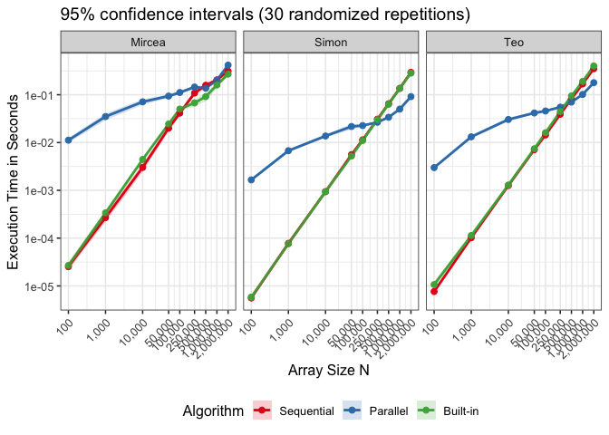
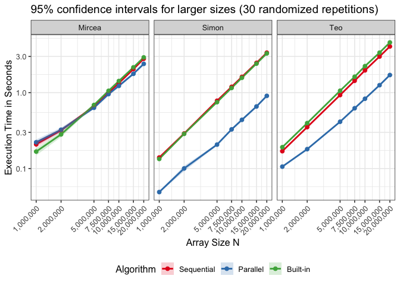
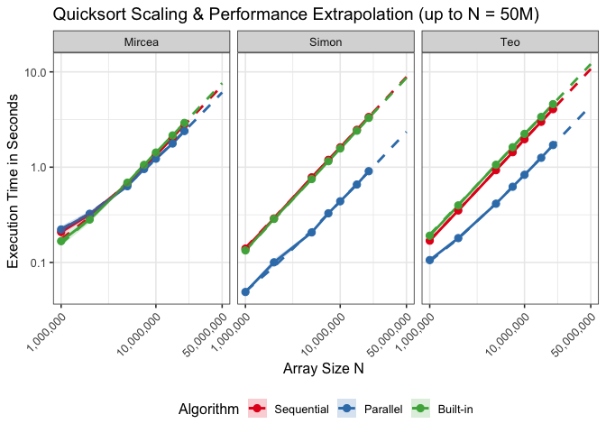

R Notebook
================
Pieleanu Mircea-Adrian, Macoveiciuc Teodor-Mihai, Quan Shan
10/11/2026

# Journal of our project:

## Specs for the devices used:

Teodor Processor Name: Dual-Core Intel Core i7 Processor Speed: 2,5 GHz
Number of Processors: 1 Total Number of Cores: 2 L2 Cache (per Core):
256 KB L3 Cache: 4 MB Hyper-Threading Technology: Enabled Memory: 8 GB

Simon Chip: Apple M2 Total number of cores: 8 (4 performance 4
efficiency) Memory: 24 GB

Mircea Model name: Intel(R) Core(TM) I7-14650HX CPU Family: 6 Thread(s)
per core: 2 Core(s) per socket: 16 \## Failed Experiment We looked at
the experiment of the student and observed this mistakes: 1. Five data
points are not enough to satisfy the Central Limit Theorem (\>=30) 2.
Array sizes were chosen strictly as powers of ten: 100, 1,000, 10,000,
100,000, and 1,000,000.The difference between 100k and 1mil is to big,
he should have choosen steps that were smaller and more useful.
3.Claiming a crossover point at 400,000 elements is an unsupported guess
rather than an empirically measured finding.

``` r
library(ggplot2)
library(dplyr)
```

    ## 
    ## Attaching package: 'dplyr'

    ## The following objects are masked from 'package:stats':
    ## 
    ##     filter, lag

    ## The following objects are masked from 'package:base':
    ## 
    ##     intersect, setdiff, setequal, union

``` r
library(scales)
```

## Our process

We did 2 benchmarks: First one is similar with the experiment of the
student, but we choose more precise steps(100 1000 10000 50000 100000
250000 500000 1000000 2000000) with 30 repetitions.We also randomized it
to avoid bias.We get the results in a csv. Second one is the same, but
from 1mil to 20 mil(1000000 2000000 5000000 7500000 10000000 15000000
20000000)

We start with the first experiment by loading the normal-scale CSV files
for all three devices (Teo, Mircea, and Simon), tagging each row with
its `Device` name, and combining them into a single dataframe.

``` r
df1 <- read.csv(file.path("data", "Teo_normal.csv"), strip.white = TRUE) %>% mutate(Device = "Teo")
df2 <- read.csv(file.path("data", "measurements_mircea-1.csv"), strip.white = TRUE) %>% mutate(Device = "Mircea")
df3 <- read.csv(file.path("data", "measurements-Simon.csv"), strip.white = TRUE) %>% mutate(Device = "Simon")

df <- bind_rows(df1, df2, df3)
df$Type <- factor(df$Type, levels = c("Sequential", "Parallel", "Built-in"))
```

We compute the mean, standard deviation, standard error, and the 95%
Confidence Interval using the Student’s t-distribution grouped by
`Device`, `Size`, and `Type`.

``` r
df_summary <- df %>%
  group_by(Device, Size, Type) %>%
  summarise(
    N = n(),
    Mean = mean(Time),
    SD = sd(Time),
    SE = SD / sqrt(N),
    CI_lower = Mean - qt(0.975, df = N - 1) * SE,
    CI_upper = Mean + qt(0.975, df = N - 1) * SE,
    .groups = "drop"
  )
```

We then plot it

``` r
p <- ggplot(df_summary, aes(x = Size, y = Mean, color = Type, fill = Type)) +
  geom_line(linewidth = 1) +
  geom_point(size = 2) +
  geom_ribbon(aes(ymin = CI_lower, ymax = CI_upper), alpha = 0.2, color = NA) +
  facet_wrap(~ Device) +
  scale_x_log10(breaks = unique(df_summary$Size), labels = label_comma()) +
  scale_y_log10() +
  scale_color_brewer(palette = "Set1") +
  scale_fill_brewer(palette = "Set1") +
  theme_bw(base_size = 12) +
  labs(
    title = "95% confidence intervals (30 randomized repetitions)",
    x = "Array Size N ",
    y = "Execution Time in Seconds",
    color = "Algorithm",
    fill = "Algorithm"
  ) + theme(
    legend.position = "bottom",
    axis.text.x = element_text(angle = 45, hjust = 1)
  )

print(p)
```

<!-- -->

``` r
ggsave("quicksort_benchmark_plot.png", p, width = 12, height = 5, dpi = 300)
```

1.  **At small sizes (100 to 50,000):** Across all three devices,
    `Parallel` (blue) is significantly slower than both `Sequential`
    (red) and `Built-in` (green) (`~1e-02` vs `~1e-05` seconds at N=100)
    because pthread creation and synchronization overhead far outweigh
    the sorting work.
2.  **In the middle (250,000 to 500,000):** `Parallel` catches up as the
    array size grows. On **Simon** (Apple M2) and **Teo** (MacBook Intel
    i7), `Parallel` crosses below `Sequential` and `Built-in` right
    around 250,000 to 500,000 elements. On **Mircea**, `Parallel` nearly
    touches `Sequential` at 500,000 elements.
3.  **At the end (1,000,000 to 2,000,000):** On **Simon** and **Teo**,
    `Parallel` continues to scale cleanly and becomes the fastest
    algorithm. However, on **Mircea**, `Parallel` curves upward and gets
    slower again at 1M–2M elements because running with
    `THREAD_LEVEL 10` spawns over 2,000 threads, overloading the OS
    scheduler (we fixed this in Experiment 2 by lowering to
    `THREAD_LEVEL 3`).

## Experiment 2

The start is the same (1,000,000 to 20,000,000 elements)

``` r
df1 <- read.csv(file.path("data", "Teo_large.csv"), strip.white = TRUE) %>% mutate(Device = "Teo")
df2 <- read.csv(file.path("data", "measurements_large_mircea.csv"), strip.white = TRUE) %>% mutate(Device = "Mircea")
df3 <- read.csv(file.path("data", "measurements-Large-Simon.csv"), strip.white = TRUE) %>% mutate(Device = "Simon")

df <- bind_rows(df1, df2, df3)
df$Type <- factor(df$Type, levels = c("Sequential", "Parallel", "Built-in"))
```

``` r
df_summary <- df %>%
  group_by(Device, Size, Type) %>%
  summarise(
    N = n(),
    Mean = mean(Time),
    SD = sd(Time),
    SE = SD / sqrt(N),
    CI_lower = Mean - qt(0.975, df = N - 1) * SE,
    CI_upper = Mean + qt(0.975, df = N - 1) * SE,
    .groups = "drop"
  )
```

``` r
p2 <- ggplot(df_summary, aes(x = Size, y = Mean, color = Type, fill = Type)) +
  geom_line(linewidth = 1) +
  geom_point(size = 2) +
  geom_ribbon(aes(ymin = CI_lower, ymax = CI_upper), alpha = 0.2, color = NA) +
  facet_wrap(~ Device) +
  scale_x_log10(
    breaks = unique(df_summary$Size),
    labels = label_comma()
  ) +
  scale_y_log10() +
  scale_color_brewer(palette = "Set1") +
  scale_fill_brewer(palette = "Set1") +
  theme_bw(base_size = 12) +
  labs(
    title = "95% confidence intervals for larger sizes (30 randomized repetitions)",
    x = "Array Size N",
    y = "Execution Time in Seconds",
    color = "Algorithm",
    fill = "Algorithm"
  ) +
  theme(
    legend.position = "bottom",
    axis.text.x = element_text(angle = 45, hjust = 1)
  )

print(p2)
```

<!-- -->

``` r
ggsave("quicksort_large_scale_plot.png", p2, width = 12, height = 5.5, dpi = 300)
```

These are our observations from Experiment 2: 1. **Mircea’s crossover
(1,000,000 to 5,000,000):** With `THREAD_LEVEL` reduced to 3,
**Mircea’s** `Parallel` execution no longer stalls; it crosses below
`Sequential` (red) and `Built-in` (green) around 2,500,000–5,000,000
elements and stays the fastest up to 20,000,000. 2. **Simon & Teo at
large scale (1,000,000 to 20,000,000):** `Parallel` (blue) is already
significantly faster at 1M elements and maintains a wide, consistent
lead over `Sequential` and `Built-in` all the way to 20M. **Simon’s**
8-core Apple M2 achieves the largest parallel speedup (finishing 20M
elements in 0.9s vs 3.2s sequential), while **Teo’s** 2-core
Hyper-Threaded i7 achieves a steady 2x speedup. 3. **Built-in `qsort` vs
Sequential:** Across all three machines past 5,000,000 elements,
`Built-in` (green) is slightly slower than or equal to our custom
`Sequential` (red) implementation due to C function-pointer comparison
overhead on every swap. 4. **Confidence Intervals:** The shaded ribbons
are extremely narrow across all three facets, confirming very low
variance across our 30 randomized repetitions.

## Extrapolation for larger scale

``` r
df_model_data <- df %>%
  filter(Size >= 500000) %>%
  mutate(Complexity = Size * log2(Size))
```

``` r
# Fit Time ~ Complexity separately for each Device and Type
models <- df_model_data %>%
  group_by(Device, Type) %>%
  do(model = lm(Time ~ Complexity, data = .))
```

We build an extrapolation grid covering our measured sizes plus two
unmeasured target sizes

``` r
extrap_sizes <- c(unique(df$Size), 30000000, 50000000)
grid_extrap  <- expand.grid(
  Device = unique(df$Device),
  Type = c("Sequential", "Parallel", "Built-in"),
  Size = extrap_sizes
) %>%
  mutate(Complexity = Size * log2(Size))
```

We generate the predicted execution times

``` r
df_extrap <- df_model_data %>%
  group_by(Device, Type) %>%
  do({
    mod <- lm(Time ~ Complexity, data = .)
    sub_grid <- filter(grid_extrap, Device == unique(.$Device), Type == unique(.$Type))
    data.frame(Size = sub_grid$Size, Time_Pred = predict(mod, sub_grid))
  }) %>%
  ungroup() %>%
  mutate(Type = factor(Type, levels = c("Sequential", "Parallel", "Built-in")))
```

We plot the empirical means and confidence intervals. Dashed lines
represent the liner regression extrapolation.

``` r
p_extrap <- ggplot() +
  geom_line(data = df_extrap, aes(x = Size, y = Time_Pred, color = Type), 
            linetype = "dashed", linewidth = 1) +
  geom_line(data = df_summary, aes(x = Size, y = Mean, color = Type), 
            linewidth = 1) +
  geom_point(data = df_summary, aes(x = Size, y = Mean, color = Type), 
             size = 2.5) +
  geom_ribbon(data = df_summary, aes(x = Size, ymin = CI_lower, ymax = CI_upper, fill = Type), 
              alpha = 0.2, color = NA) +
  facet_wrap(~ Device) +
  scale_x_log10(labels = label_comma(), breaks = c(1000, 100000, 1000000, 10000000, 50000000)) +
  scale_y_log10() +
  scale_color_brewer(palette = "Set1") +
  scale_fill_brewer(palette = "Set1") +
  theme_bw(base_size = 12) +
  labs(
    title = "Quicksort Scaling & Performance Extrapolation (up to N = 50M)",
    x = "Array Size N ",
    y = "Execution Time in Seconds ",
    color = "Algorithm",
    fill = "Algorithm"
  ) +
  theme(
    legend.position = "bottom",
    axis.text.x = element_text(angle = 45, hjust = 1)
  )

print(p_extrap)
```

<!-- -->

``` r
ggsave("quicksort_extrapolation_plot.png", p_extrap, width = 12, height = 5.5, dpi = 300)
```

Observations on the Extrapolation (up to N = 50M): 1. **Model Fit:** The
dashed regression lines align tightly with the empirical data points
from 1M to 20M across all three devices, confirming that all three
implementations closely follow the theoretical O(N \_2 N) average-case
complexity at scale. 2. **Projected Performance at N = 50M:** `Parallel`
remains the fastest algorithm on every platform. At 50,000,000 elements,
**Simon’s** Apple M2 is projected to finish in 2.3 seconds (compared to
8.5s for Sequential/Built-in), **Teo’s** i7 in 4.5 seconds (vs 10s
Sequential), and **Mircea’s** i7-14650HX in 6.5 seconds (vs 8s
Sequential).
