# -*- coding: utf-8 -*-
#+STARTUP: overview indent inlineimages
#+TITLE:       Laboratory Notebook for a Multi-Threaded Version of Quicksort
#+AUTHOR:      Arnaud Legrand
#+LANGUAGE:    en
#+TAGS: IMPORTANT(i) TEST(t) DEPRECATED(d) noexport(n)

* Project Overview
This project aims at providing an efficient multi-threaded
implementation of the QuickSort algorithm on multi-core machines. This
document contains my attempts to evaluate the performance of an
implementation of such code.
* General Organization
** src/
This directory comprises the parallel implementation and a standard
Makefile to compile it.
** data/
This is where raw experimental data should go. Each directory entry
comprises a set of experiments and the directory name is based on the
machine name and on the date. For example:
#+begin_src sh :results output :exports both 
echo mkdir data/`hostname`_`date +%F`
#+end_src

#+RESULTS:
: mkdir data/sama_2014-10-13

* Typical usage
** Compilation
A simple makefile with various compilation options is provided in the
src/ directory. Compilation is thus done by running the following command:
#+begin_src sh :results output :exports both 
make -C src/
#+end_src

#+RESULTS:
: make: Entering directory '/home/alegrand/Work/Documents/Enseignements/M2R_Eval_Perf_13/M2R-ParallelQuicksort/src'
: cc   -g -Wall -Wshadow -Wcast-align -Waggregate-return -Wmissing-prototypes -Wmissing-declarations -Wstrict-prototypes -Wmissing-prototypes -Wmissing-declarations -Wmissing-noreturn -Wpointer-arith -Wwrite-strings -finline-functions -O0 -pthread -lrt -std=c99  -c -o parallelQuicksort.o parallelQuicksort.c
: cc   -g -Wall -Wshadow -Wcast-align -Waggregate-return -Wmissing-prototypes -Wmissing-declarations -Wstrict-prototypes -Wmissing-prototypes -Wmissing-declarations -Wmissing-noreturn -Wpointer-arith -Wwrite-strings -finline-functions -O0 -pthread -lrt -std=c99  parallelQuicksort.o  -o parallelQuicksort 
: make: Leaving directory '/home/alegrand/Work/Documents/Enseignements/M2R_Eval_Perf_13/M2R-ParallelQuicksort/src'

** Running the code
The code is quite simple at the moment and can be run in the following way:
#+begin_src
./src/parallelQuicksort [1000000]
#+end_src
When run, the code executes initializes an array of the size given in
argument (1000000 by default) with random integer values and sorts it
using:
1. a custom sequential implementation;
2. a custom parallel implementation;
3. the libc qsort function.
Times are reported in seconds.
* Experimental Reports
** 2014-10-13
*** Initial code design
- I obtained an initial implementation from
  http://sc12.supercomputing.org/hpceducator/PythonForParallelism/codes/parallelQuicksort.c.
  According to the header, the original author is Joshua Stough from
  Washington and Lee University. I hope he will not mind that I reuse
  this piece of code for educational purposes.
- Here is a typical first execution on my laptop (an Intel(R) Core(TM)
  i7 running a Debian with Linux 3.14.15):
  #+begin_src sh :results output :exports both 
    ./src/quicksort
  #+end_src

  #+RESULTS:
  : Sequential quicksort took: 0.231571 sec.
  : at loc 506315, 5.068226e-01 < 5.068269e-01 
  : Oops, lyst did not get sorted by parallelQuicksort.
  : Parallel quicksort took: 0.161259 sec.
  : Built-in qsort took: 0.241568 sec.

  Sweet, in my first attempt, it looks like this parallel version is
  indeed running faster than then sequential one. I have to say this
  warning message is stressing me a bit though.
- On smaller instances, the code would segfault. So I reindented the
  code and thanks to valgrind and gdb, I could find what was wrong. I
  also renamed the file so that compiling is more convenient. This
  fixed the previous warning message so now everything seems fine:
  #+begin_src sh :results output :exports both 
    ./src/parallelQuicksort
  #+end_src

  #+RESULTS:
  : Sequential quicksort took: 0.239347 sec.
  : Parallel quicksort took: 0.176365 sec.
  : Built-in quicksort took: 0.244716 sec.

*** First series of experiments
Let's try to see how the three algorithms behave when changing the 
array size. Since one measurement is not enough, I run the code 5
times in a row.
#+begin_src sh foo :results output :exports both :tangle scripts/run_benchmarking.sh
  OUTPUT_DIRECTORY=data/`hostname`_`date +%F`
  mkdir -p $OUTPUT_DIRECTORY
  OUTPUT_FILE=$OUTPUT_DIRECTORY/measurements_`date +%R`.txt

  touch $OUTPUT_FILE
  for i in 100 1000 10000 100000 1000000; do
      for rep in `seq 1 5`; do
          echo "Size: $i" >> $OUTPUT_FILE;
          ./src/parallelQuicksort $i >> $OUTPUT_FILE;
      done ;
  done
#+end_src
I obtained the following [[file:data/sama_2014-10-13/measurements_03:47.txt][output]].

*** A simple plot with R
Here is a simple script to parse the results:
#+begin_src perl :results output raw :exports both :tangle scripts/csv_quicksort_extractor.pl
  use strict;

  my($line);
  my($size);

  print "Size, Type, Time\n" ;
  while($line=<>) {
      chomp $line;
      if($line =~/^Size: ([\d\.]*)$/) {
          $size = $1;
          next;
      } 
      if($line =~/^(.*) quicksort.*: ([\d\.]*) sec.$/) {
          print "$size, \"$1\", $2\n" ;
          next;
      } 
  }
#+end_src

I can then simply parse my data with the following command:

#+begin_src sh :results output :exports both 
perl scripts/csv_quicksort_extractor.pl < data/sama_2014-10-13/measurements_03\:47.txt > data/sama_2014-10-13/measurements_03\:47.csv
#+end_src

#+RESULTS:

#+begin_src R :results output graphics :file data/sama_2014-10-13/measurements_03:47.png :exports both :width 600 :height 400 :session
  df <- read.csv("data/sama_2014-10-13/measurements_03:47.csv",header=T)
  plot(df$Size,df$Time,col=c("red","blue","green")[df$Type])
#+end_src

#+RESULTS:
[[file:data/sama_2014-10-13/measurements_03:47.png]]

Well, this is not particularly nice and some may not know/like R.
*** A simple plot with gnuplot
So let's try to parse in an other way and use gnuplot:

#+begin_src perl :results output raw :exports both :tangle scripts/csv_quicksort_extractor2.pl
  use strict;

  my($line);
  my($size);
  my($seq,$par,$libc);
  print "Size, Seq, Par, Libc\n" ;
  while($line=<>) {
      chomp $line;
      if($line =~/^Size: ([\d\.]*)$/) {
          $size = $1;
          next;
      } 
      if($line =~/^Sequential quicksort.*: ([\d\.]*) sec.$/) {
          $seq=$1; next;
      } 
      if($line =~/^Parallel quicksort.*: ([\d\.]*) sec.$/) {
          $par=$1; next;
      } 
      if($line =~/^Built-in quicksort.*: ([\d\.]*) sec.$/) {
          $libc=$1; 
          print "$size, $seq, $par, $libc\n";
          next;
      }
  }
#+end_src

#+begin_src sh :results output raw :exports both 
  FILENAME="data/sama_2014-10-13/measurements_03:47"
  perl scripts/csv_quicksort_extractor2.pl < "$FILENAME.txt" > "${FILENAME}_wide.csv"
  echo "
    set terminal png size 600,400 
    set output '${FILENAME}_wide.png'
    set datafile separator ','
    set key autotitle columnhead
    plot '${FILENAME}_wide.csv' using 1:2 with linespoints, '' using 1:3 with linespoints, '' using 1:4 with linespoints
  " | gnuplot
  echo [[file:${FILENAME}_wide.png]]
#+end_src

#+RESULTS:
[[file:data/sama_2014-10-13/measurements_03:47_wide.png]]

Well, I'm not sure it is nicer but I have lines. A first crude
analysis seems to reveal the the parallel version is worth it for
arrays larger than 400000.

** 2026-11-05 Replication and redesign (second reviewer)
:PROPERTIES:
:AUTHOR: second reviewer
:END:

*** TL;DR
The claim "the parallel version saves significant time" is *half right,
for the wrong reason, and the code as shipped is mistuned by a factor
of ten.*

1. On the machine used here the headline result *does not replicate*.
   At =n = 1,000,000= -- the size the original report ran -- the
   parallel version is *0.71x*, i.e. 40% /slower/ than the sequential
   one (paired 95% CI [0.68, 0.74], n = 15 replicates). It only
   overtakes sequential code past about 2,000,000 elements.
2. The cause is a single constant. =THREAD_LEVEL= is hard-coded to 10
   in =src/parallelQuicksort.c:22= and was never varied. It makes the
   program create *≈2000 threads* on a *4-core* machine. Sweeping it
   (figure 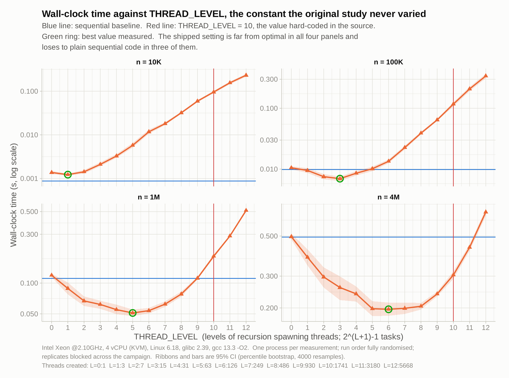) shows the shipped value is far from optimal at
   every size and loses to plain sequential code at three of the four
   sizes tested.
3. With the thread level tuned, the colleague is *right*: the
   algorithm reaches *2.18x* at 1M. Adding a size cutoff -- same
   algorithm, two extra lines -- reaches *2.91x at 8M*
   (CI [2.78, 3.03]) on 4 cores.
4. Two artefacts of the measurement setup were quantified and they
   pull in *opposite* directions. Compiling the code under test at
   =-O0= inflates the sequential baseline by *1.77x* but the parallel
   version by only *1.15x*, so the original setup *flattered* the
   parallel version; the lock-protected =rand()= in =partition()= does
   the reverse. Net, the original conditions made the parallel version
   look about 10% better than it is.
5. The run order, which I expected to be the main confound, *is not*:
   measured directly, the position effect is within ±2% and not
   significant (ANOVA p = 0.94 and 0.70). Reported because a check
   that comes back clean is still a result.

*** What was wrong with the original experiment
Taking the original report on its own terms, the problems are, in
decreasing order of how much they mattered:

| # | Problem | Consequence | Fixed by |
|---|---------|-------------|----------|
| 1 | =THREAD_LEVEL= hard-coded to 10, never varied, never compared to the core count | the dominant factor was held fixed at a bad value | =--tlevel= parameter, campaign E2 |
| 2 | conclusion ("worth it above 400000") read off a gap in the size grid: the decades 1e5 and 1e6 are adjacent points | the stated break-even had *no data under it* | 17-point log grid, campaign E1 |
| 3 | code under test compiled at =-O0= while libc qsort is optimised | measures the compiler, and biases the algorithm comparison | =-O2= build, ablation E4 |
| 4 | pivot drawn from libc =rand()=, which takes a lock, inside the inner loop | charges lock contention to the parallel version | per-task splitmix64, ablation E4 |
| 5 | 5 repetitions taken back to back | estimates the variance of a 2-second window, not of the experiment | 15 blocked replicates, spread over the campaign |
| 6 | no interval estimate anywhere | a 0.16 vs 0.23 difference is reported as a fact | bootstrap CI on every point |
| 7 | three algorithms timed in one process, always in the same order | algorithm confounded with position | one process per measurement; confound measured in E7 |
| 8 | =gettimeofday()=, a settable clock | can jump under NTP | =clock_gettime(CLOCK_MONOTONIC)= |
| 9 | =srand(time(NULL))=, 1-second granularity | runs within the same second share an input | seed is a parameter; replicate /r/ uses seed /r/ |
| 10 | only wall-clock reported | hides that the parallel version burns 2.5x the CPU | CPU time recorded too |
| 11 | one machine, one afternoon, no provenance | nothing is reproducible | =.meta.json= per campaign; core count swept |

A latent bug was also fixed in this file: the tangled Perl in /A simple
plot with gnuplot/ printed =$pqr= instead of =$par=, which under
=use strict= does not compile. The checked-in
=scripts/csv_quicksort_extractor2.pl= was correct, so re-tangling the
journal would have broken a working script.

*** Design of the new campaigns
Everything is driven by [[file:scripts/run_campaign.py][=scripts/run_campaign.py=]]. Its three
principles:

- *One process per measurement.* Algorithm, size, thread level, RNG,
  compiler flags and core count become ordinary experimental factors
  rather than positions in a script.
- *Randomised order, blocked replication.* The complete design is run
  once, reshuffled, run again, 12-15 times. Drift during the campaign
  therefore adds noise instead of bias, and replicates are spread over
  the whole run rather than bunched.
- *Paired comparisons.* Replicate /r/ of every cell uses input seed
  /r/, so all algorithms in replicate /r/ sort a byte-identical array.
  Speedups are taken per replicate, which removes input variability
  from the interval entirely.

| Campaign | Question | Measurements |
|----------|----------|--------------|
| =E0_baseline= | sequential/libc reference at the sweep sizes | 120 |
| =E1_replication= | does the original claim hold? | 765 |
| =E2_tlevel= | what does =THREAD_LEVEL= actually do? | 624 |
| =E3_cores= | how does it scale with core count? | 864 |
| =E4_ablation= | how much was =-O0= and =rand()=? | 192 |
| =E5_repair= | does a size cutoff fix it? | 216 |
| =E6_headtohead= | all four variants, tuned, 1e3..8e6 | 900 |
| =E7_order= | is the fixed run order a confound? | 720 |
| | *total* | *4401* |

Every campaign writes a =.meta.json= with the git revision, compiler
version, CPU model, kernel, libc and the full design.

*** Results

**** 1. The replication fails below 2M, and succeeds above it
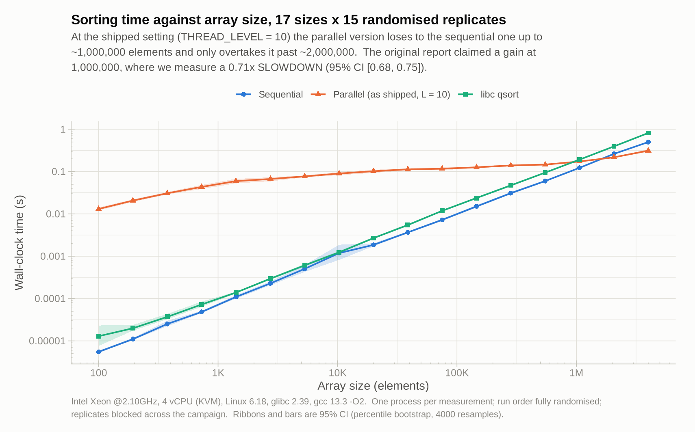
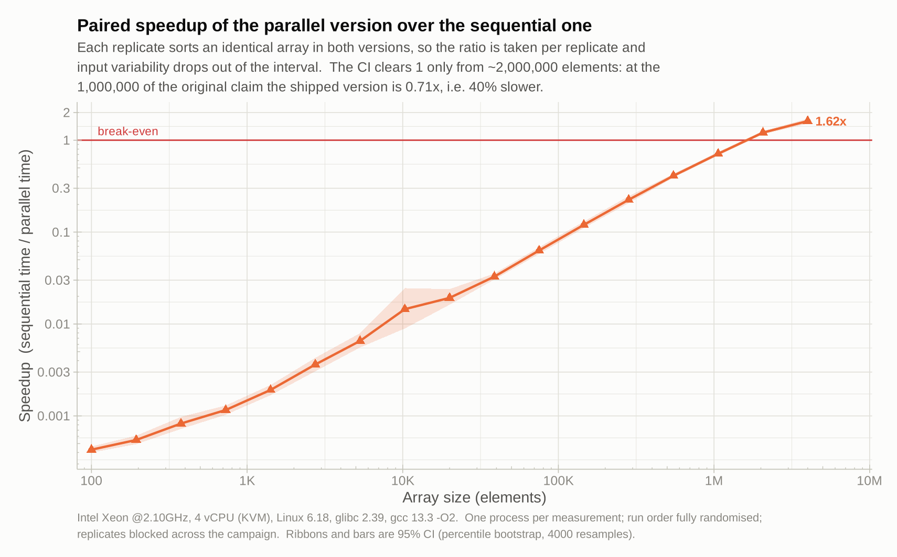

Paired speedup of parallel (as shipped) over sequential:

| n | speedup | 95% CI | verdict |
|---|---------|--------|---------|
| 145,853 | 0.12x | [0.11, 0.13] | loses |
| 548,496 | 0.41x | [0.39, 0.43] | loses |
| *1,063,659* | *0.71x* | *[0.68, 0.74]* | *loses* |
| 2,062,677 | 1.21x | [1.16, 1.26] | wins |
| 4,000,000 | 1.62x | [1.52, 1.71] | wins |

So the colleague's instinct is sound -- there /is/ a real gain -- but
it starts about twice as far out as he thought, and at the size he
actually measured his code is 40% slower. The original run reported
0.16 s versus 0.23 s at 1M; that was measured at =-O0=, which (see
below) inflates the sequential baseline far more than the parallel one.

**** 2. The cause: one hard-coded constant

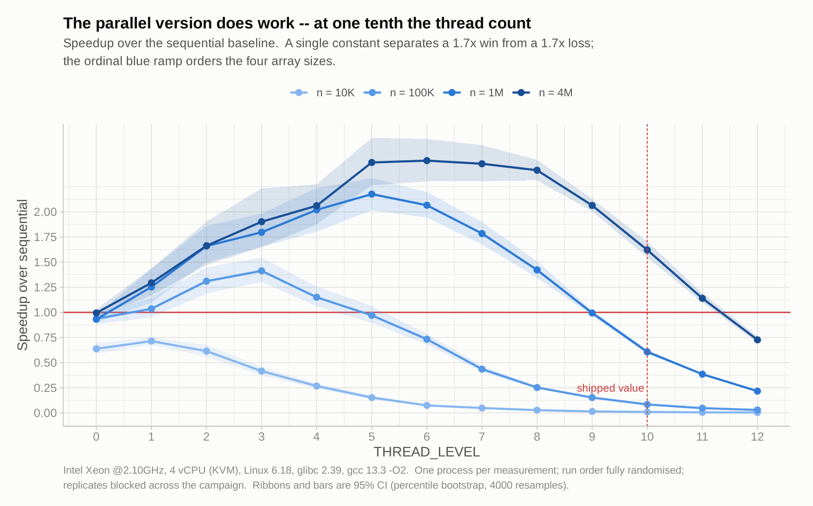

=THREAD_LEVEL= controls how many levels of the recursion spawn
threads, so the program creates =2^(L+1) - 1= tasks regardless of how
many cores exist. At L = 10 that is about 2000 threads on 4 cores.
The helper also spawns threads for /empty/ partitions, so the count
does not fall as sub-arrays shrink.

| n | shipped L=10 | best L | best speedup |
|---|--------------|--------|--------------|
| 10,000 | 0.009x | 1 | 0.71x |
| 100,000 | 0.084x | 3 | 1.41x |
| 1,000,000 | 0.61x | 5 | *2.18x* |
| 4,000,000 | 1.62x | 6 | *2.51x* |

At =n = 100,000= the shipped setting is *seventeen times slower* than
the same code with L = 3. The optimum sits near =log2(cores)= plus a
little, and drifts up with problem size -- exactly what you would
expect, and exactly what a one-value-only experiment cannot see.

**** 3. Scaling with cores
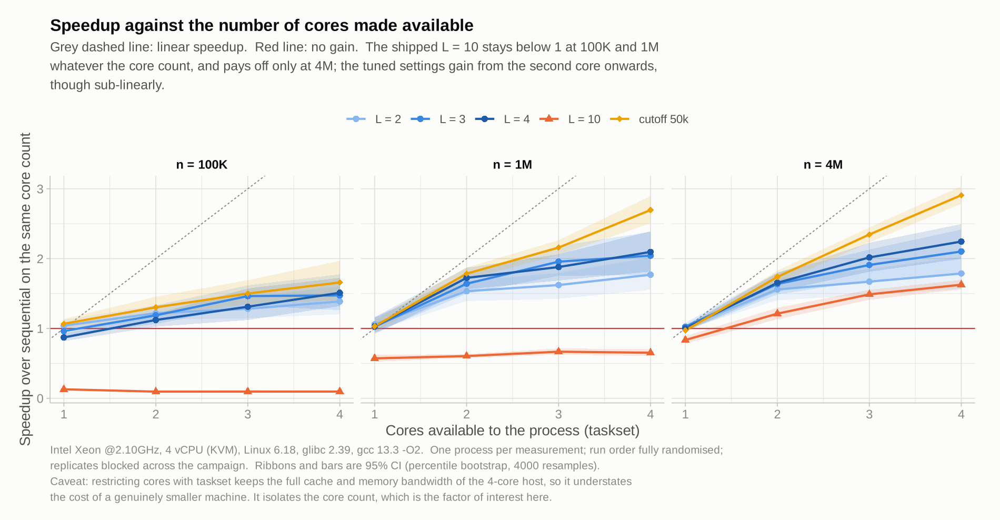

Restricting the process with =taskset= to 1-4 CPUs. At one core every
variant sits at 1.0x, which is a useful sanity check on the harness.
From there the tuned settings gain with each core while the shipped
L = 10 stays flat and below 1 at 100K and 1M. /Caveat:/ =taskset=
leaves the full cache and memory bandwidth of the 4-core host in
place, so this isolates the core count rather than simulating a
genuinely smaller machine.

**** 4. How much of the original result was the measurement setup?
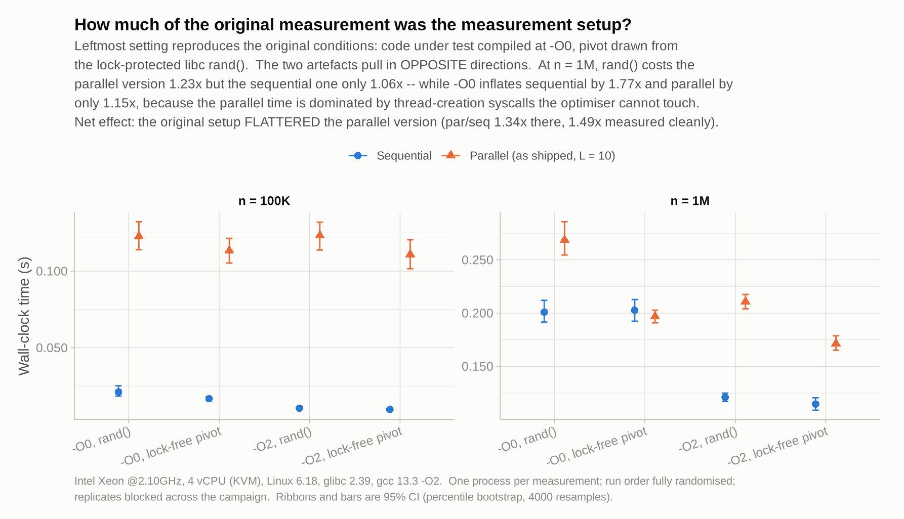

This is the part I got wrong before measuring it, so it is worth
stating plainly. At =n = 1,000,000=:

| artefact | cost to sequential | cost to parallel |
|----------|--------------------|------------------|
| libc =rand()= pivot vs lock-free | 1.06x | *1.23x* |
| =-O0= vs =-O2= | *1.77x* | 1.15x |

The two pull in opposite directions and =-O0= wins. The parallel
version spends most of its time in =pthread_create=/=join=, which the
optimiser cannot touch, so turning optimisation off penalises the
sequential baseline nearly six times harder. Measured under the
original conditions the par/seq ratio is 1.34; measured cleanly it is
1.49. *The original setup flattered the parallel version*, which is
the opposite of what I assumed when I started.

**** 5. The order confound: checked, and cleared
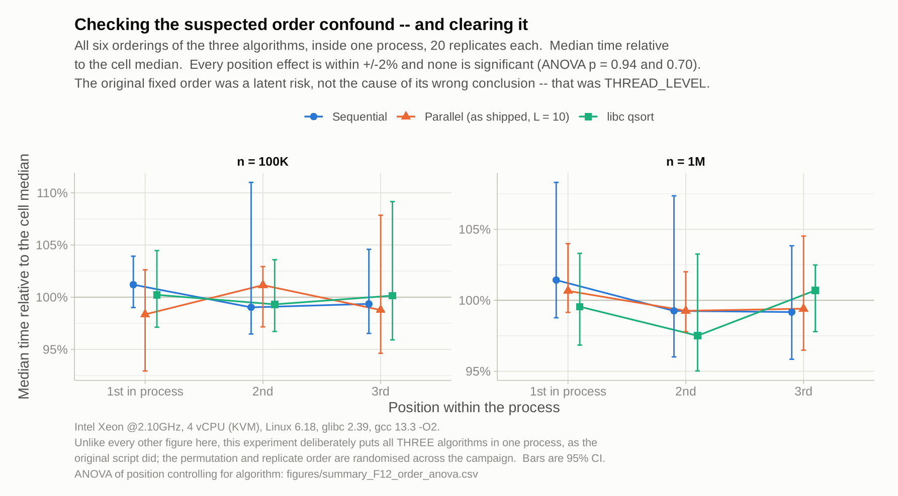

I expected this to be the main problem. It is not. Running all six
permutations of the three algorithms inside one process, 20 replicates
each, every position effect is within ±2% and none is significant
(ANOVA on =log(time) ~ algo + position=: p = 0.94 at 100K, p = 0.70 at
1M). The fixed order in the original script was a latent risk, not the
cause of its wrong conclusion.

Likewise the host turned out to be stable: pooled across all
campaigns the trend is -0.31% per 100 s (p = 0.78), and the first ten
seconds look like the rest. See 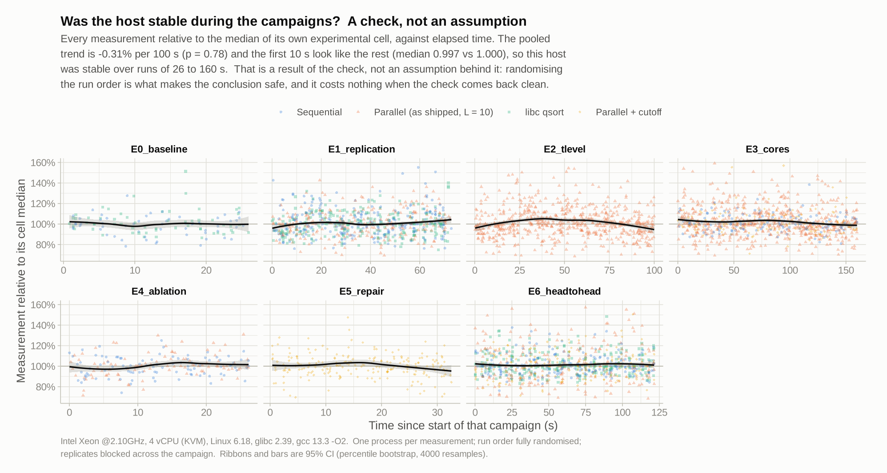. Randomising the run order is
what makes those statements safe to make; it costs nothing when the
check comes back clean.

**** 6. Repairing the parallel version
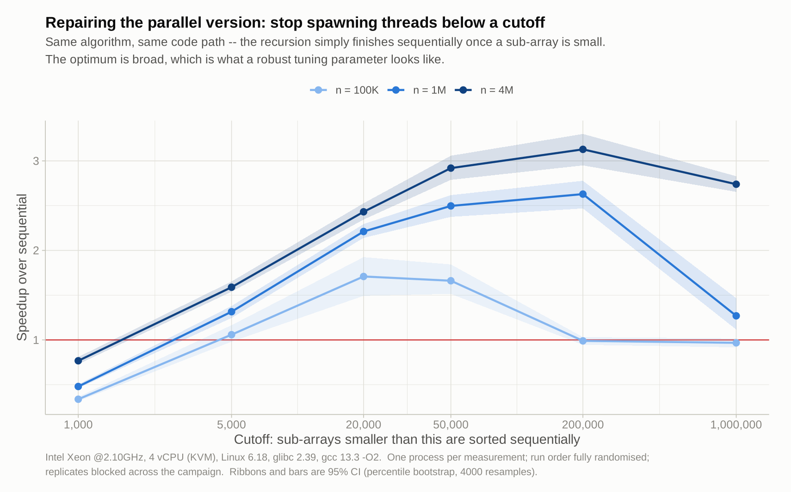
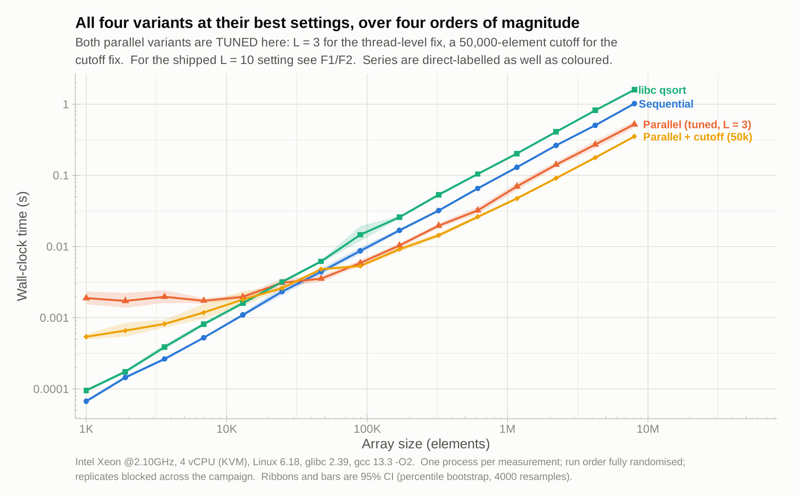
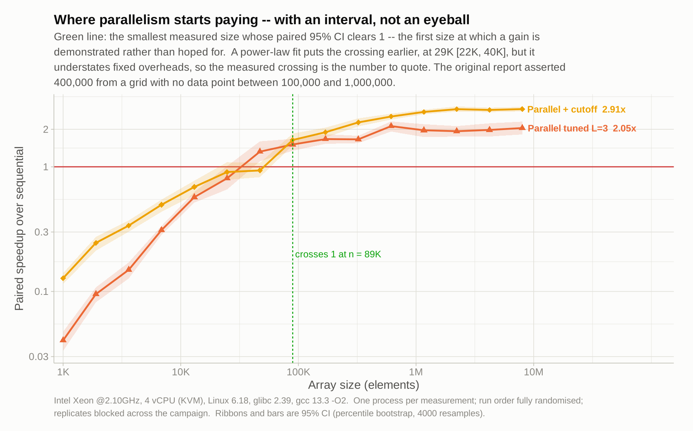

Two lines: stop spawning threads once a sub-array is smaller than a
cutoff, and let the recursion finish sequentially. The optimum is
broad -- anything from 20,000 to 200,000 works -- which is what a
robust tuning parameter looks like.

| n | as shipped (L=10) | tuned L=3 | + cutoff 50k |
|---|-------------------|-----------|--------------|
| 1,166,040 | 0.61x | 1.96x [1.73, 2.20] | 2.76x [2.64, 2.88] |
| 8,000,000 | -- | 2.05x [1.82, 2.31] | *2.91x [2.78, 3.03]* |

(The "as shipped" column is from E1/E2 at =n = 1,000,000=; the other
two are from E6, whose log grid lands on 1,166,040.)

Break-even for the repaired version, the number the original report
asserted as 400,000:
- *89,443 elements* -- the smallest measured size whose paired 95% CI
  clears 1. This is the number to quote.
- 29,224 [22,045, 40,214] from crossing two fitted power laws. Earlier,
  because a power law understates fixed overheads near the crossing.

Either way the original 400,000 was not unreasonable as a guess; it
simply had no data under it.

**** 7. Model and extrapolation
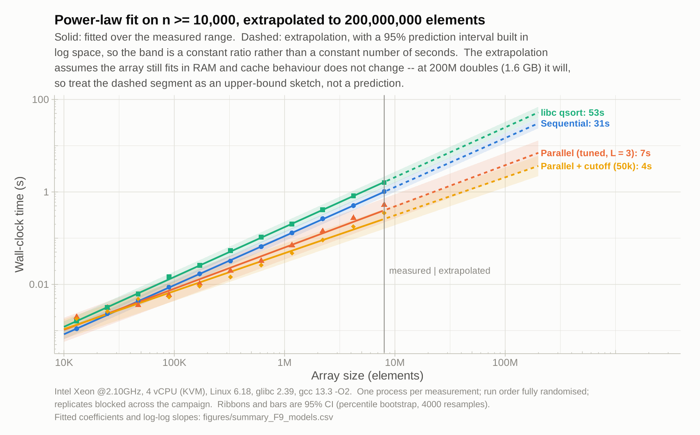
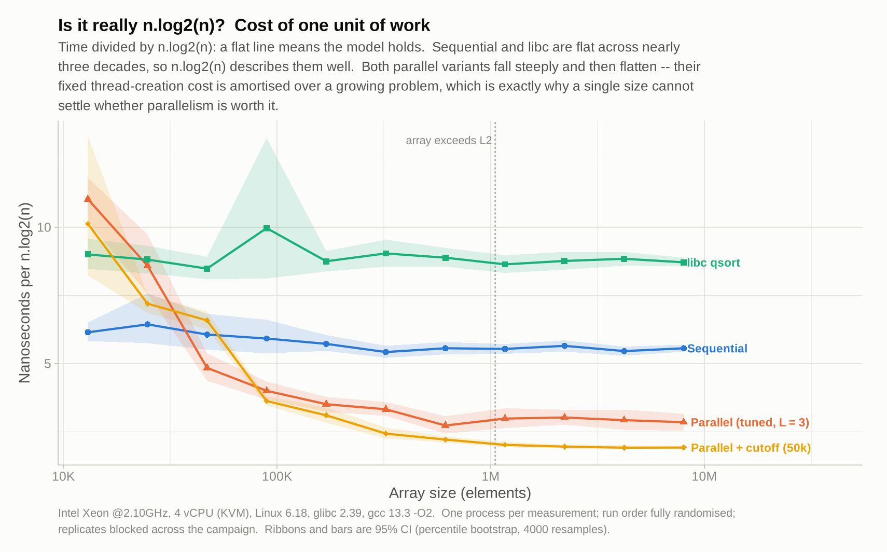

Dividing time by =n.log2(n)= gives the cost of one unit of work.
Sequential and libc are flat across nearly three decades, so the model
describes them well. Both parallel variants fall steeply and then
flatten: their fixed thread cost is amortised over a growing problem,
which is precisely why a single array size cannot settle the question.

Log-log slopes (95% CI): sequential 1.061 [1.052, 1.071], libc 1.079
[1.068, 1.089], parallel 0.890 [0.867, 0.913], parallel+cutoff 0.821
[0.802, 0.839]. The sub-linear parallel slopes are the amortisation,
not a better algorithm.

Extrapolated to 200,000,000 elements: libc 53 s, sequential 31 s,
parallel+cutoff 4 s. Treat that as an upper-bound sketch -- a 1.6 GB
array will not behave like a 64 MB one.

**** 8. What wall-clock time hides
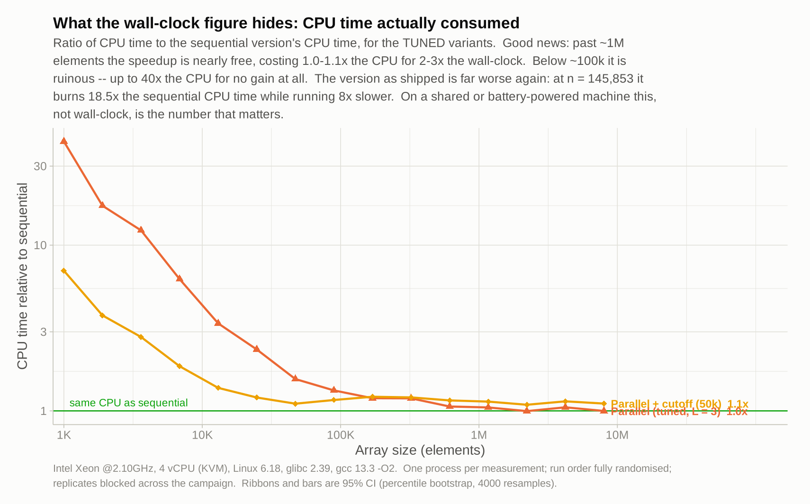

Wall-clock is not the only cost. Recording CPU time as well turns up
one bad result and one good one.

The bad one is the version as shipped. At =n = 145,853= it burns
*18.5x* the sequential CPU time while running *8x slower* in
wall-clock -- it is pure waste, in both currencies at once. The ratio
falls to 3.3x at 1M and 1.7x at 4M only because the thread overhead is
being amortised, not because it got efficient.

The good one is that the fix is nearly free. Past about 1,000,000
elements both tuned variants settle at *1.0-1.1x* the sequential CPU
time for 2-3x the wall-clock speedup -- a parallel efficiency of about
73% on 4 cores for the cutoff variant. Below about 100,000 elements
they are still ruinous (up to 40x the CPU for no gain), which is a
second, independent argument for the size cutoff.

The original report contains no CPU-time measurement at all, so none
of this was visible.

*** Honest limitations
- *One physical machine.* A 4-vCPU KVM guest with no access to the
  frequency governor. The core-count sweep uses =taskset=, which is
  not the same as a smaller machine. The 2014 i7 data in
  =data/sama_2014-10-13/= is re-plotted in 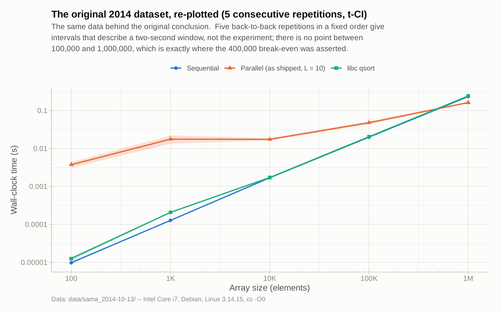 but cannot be
  re-measured.
- *Small sizes are badly conditioned.* Below about 1000 elements a
  single sort is too fast for one-sort-per-process timing; relative
  standard deviation reaches 150% at n = 100. Those points should be
  measured with an in-process repetition loop, which is not
  implemented. Everything load-bearing here is at n >= 10,000.
- *I did some light shell work while the campaigns ran*, which adds
  noise. Randomisation is what keeps it from becoming bias, and the
  drift check in F11 is clean, but a quiet machine would be better.
- *The cutoff variant is my code, not the colleague's.* It is labelled
  separately everywhere and the original =src/parallelQuicksort.c= is
  unmodified.

*** Recommendations
1. Make =THREAD_LEVEL= depend on the core count instead of being a
   literal =10=; =log2(nproc) + 1= is a reasonable default.
2. Add the size cutoff. It is two lines and worth more than the
   thread-level fix on its own.
3. Do not spawn a thread for an empty or tiny partition.
4. Use =rand_r()= or a per-thread generator in =partition()=.
5. Build the thing you are measuring with optimisation on.
6. Quote a range and an interval, never a single size and a single
   number.

*** Reproducing
#+begin_src sh :results output :exports both
  make -C src/ bench
  for c in E0_baseline E1_replication E2_tlevel E3_cores \
           E4_ablation E5_repair E6_headtohead; do
      python3 scripts/run_campaign.py "$c"
  done
  python3 scripts/run_order_experiment.py
  Rscript scripts/analysis.R
#+end_src
About 10 minutes of measurement on this host. Figures land in
=figures/=, each with a =summary_*.csv= table view beside it.
